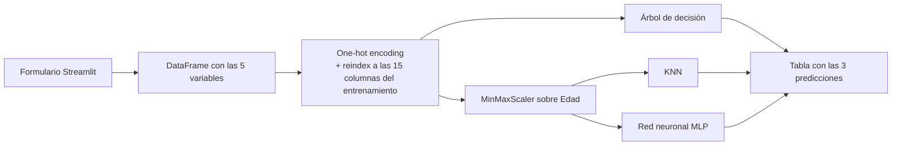

# Predicción de inversión en una tienda de videojuegos

Aplicación web en **Streamlit** que estima cuánto invertirá un cliente en una tienda de videojuegos a partir de su perfil: edad, sexo, si es consumidor habitual, videojuego y plataforma. Compara en paralelo la predicción de **tres modelos de regresión**: árbol de decisión, KNN y red neuronal.

> Autor: **Sebastián Muñoz Palacio**

**Stack:** Python · pandas · scikit-learn · Streamlit

---

## Cómo funciona



1. **Entrada:** el usuario elige los valores en el formulario.

   | Variable | Valores |
   |---|---|
   | Edad | 14 a 52 años |
   | Videojuego | Mass Effect, Battlefield, Fifa, KOA: Reckoning, Crysis, Sim City, Dead Space, F1 |
   | Plataforma | Play Station, Xbox, PC, Otros |
   | Sexo | Hombre, Mujer |
   | Consumidor habitual | True, False |

2. **Preparación:** las variables categóricas se convierten con *one-hot encoding* y se alinean con las 15 columnas usadas en el entrenamiento (`reindex`). Así, una categoría que no aparece en el registro queda en 0 y el orden de las columnas coincide con el del modelo.
3. **Escalado:** KNN y la red neuronal usan distancias o pesos sensibles a la escala. Por eso la edad pasa por el mismo `MinMaxScaler` del entrenamiento. Se usa solo `transform`, nunca `fit`, para no reajustar el escalador con datos nuevos.
4. **Predicción:** los tres modelos predicen sobre el mismo registro y la app muestra los resultados lado a lado.

## Modelos

Los tres modelos, el escalador y la lista de columnas están serializados juntos en `modelo.pkl`:

| Componente | Configuración |
|---|---|
| `DecisionTreeRegressor` | Sin límite de profundidad (quedó con profundidad 11 y 34 hojas) |
| `KNeighborsRegressor` | `n_neighbors = 1` |
| `MLPRegressor` | 1 capa oculta de 16 neuronas, activación ReLU, 500 iteraciones |
| `MinMaxScaler` | Ajustado sobre `Edad` |
| `variables` | Las 15 columnas de entrada, en el orden del entrenamiento |

### Ejemplo de predicciones

| Edad | Videojuego | Plataforma | Sexo | Habitual | Árbol | KNN | Red neuronal |
|---|---|---|---|---|---|---|---|
| 20 | Fifa | Play Station | Hombre | Sí | 310 | 310 | 242 |
| 35 | Sim City | PC | Mujer | No | 92 | 100 | 100 |
| 45 | Battlefield | Xbox | Hombre | Sí | 750 | 370 | 1,267 |

Los modelos coinciden en perfiles comunes y divergen en los menos frecuentes (tercera fila). Esto es esperable con un árbol sin poda y un KNN con un solo vecino, que tienden a memorizar los datos de entrenamiento.

## Cómo ejecutarlo

```bash
pip install -r requirements.txt
streamlit run app.py
```

La app se abre en `http://localhost:8501`.

## Estructura

| Archivo | Contenido |
|---|---|
| [`app.py`](app.py) | Aplicación Streamlit: formulario, preparación de datos y predicción |
| [`modelo.pkl`](modelo.pkl) | Modelos entrenados, escalador y lista de columnas |
| [`requirements.txt`](requirements.txt) | Dependencias |

## Limitaciones y mejoras posibles

- **Entrenamiento no incluido:** el entrenamiento y la evaluación se hicieron en un notebook aparte (Google Colab) que no está en el repositorio, así que aquí no se reportan métricas.
- **Sobreajuste:** un árbol sin `max_depth` y un KNN con `k = 1` son propensos a sobreajustar. Ajustar estos hiperparámetros con validación cruzada debería hacer las predicciones más estables.
- **Formato del modelo:** el `.pkl` depende de la versión de scikit-learn con que se guardó. Fijar las versiones en `requirements.txt` evitaría incompatibilidades.
